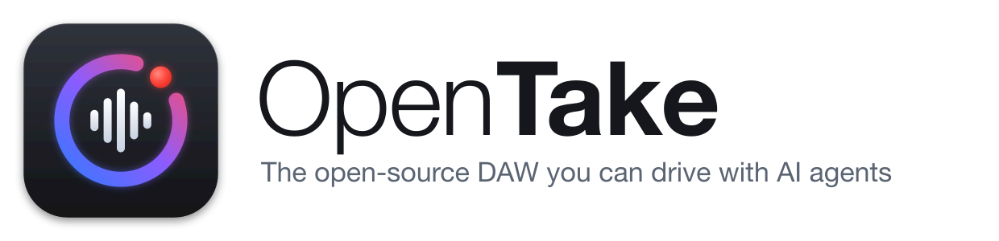

<p align="center">
  <picture>
    <source media="(prefers-color-scheme: dark)" srcset="assets/logo/opentake-wordmark-dark.png">
    
  </picture>
</p>

# OpenTake

**The open-source DAW you can make music with — together with your AI agent.**

OpenTake is a fast, native digital audio workstation written in Rust. Record from your
audio interface, arrange audio and MIDI, play VST3 instruments and effects, and mix —
in a clean, Logic-inspired interface. Every part of a session is also exposed over the
[Model Context Protocol](https://modelcontextprotocol.io), so an AI agent can work in the
same project you have open: create tracks, write MIDI, set up plug-ins, edit and mix while
you watch the changes appear live — and undo anything you don't like.

- 🎙️ Multitrack recording from any audio interface (CoreAudio, WASAPI, ALSA/JACK via cpal)
- 🎹 Instrument tracks, piano roll, a built-in synth and GM drum kit; VST3 instruments and effects
- ✂️ Region editing: select, move, copy, split, trim, snap, cycle/loop
- 🎚️ Full mixer, metronome, undo/redo for everything
- 🤖 MCP server (stdio or HTTP) with 45 tools — the agent and you share one session
- 📂 Opens and saves Reaper `.rpp` projects as well as its own `.json` format
- 🎸 Imports Guitar Pro 7/8 songs (`.gp`) as MIDI tracks for VST instruments or the built-in synth, with the tablature shown in sync with the timeline
- 🦀 Real-time safe audio engine: no locks or allocation on the audio thread

## Download

Prebuilt binaries for Linux, Windows and macOS (Apple Silicon and Intel) are on the
[Releases page](https://github.com/jalagus/opentake/releases): the **Nightly build** is
rebuilt from `main` on every push, and tagged versions (`v*`) get their own release.

The builds aren't signed yet:

- **macOS**: unzip and move `OpenTake.app` to Applications. The first time, right-click it →
  Open (or run `xattr -dr com.apple.quarantine /Applications/OpenTake.app`).
- **Windows**: SmartScreen may warn — choose More info → Run anyway.
- **Linux**: needs ALSA and GTK 3 (`libasound2`, `libgtk-3-0`), present on most desktops.

## Layout

| Crate | What it does |
|---|---|
| `crates/opentake-project` | Project model (tracks, clips, plugin slots), Reaper `.rpp` import/export, Guitar Pro 7/8 reader |
| `crates/opentake-vst3` | VST3 hosting: bundle scanning, loading, parameters, state, realtime processing |
| `crates/opentake-engine` | cpal audio I/O, lock-free mixer, WAV recorder, control-side `Engine` API |
| `crates/opentake` | `opentake` binary: egui GUI, MCP server (stdio or streamable HTTP), small CLI |

### Realtime design

```
 MCP tools ──▶ Engine (control thread) ──Command ring──▶ Mixer (audio callback)
                    ▲                                      │  │
                    └──────── Garbage ring (freed here) ◀──┘  └─▶ record ring ─▶ Recorder thread ─▶ WAV
```

The audio callback never locks or allocates. Structural changes (new track, inserted
plugin, ...) are built on the control side and sent as boxes over an `rtrb` ring;
anything removed is returned and dropped on a GC thread. Input is passed from the
input stream to the output stream through another ring, and recording copies raw
input to a disk-writer thread.

## Usage

```sh
cargo build --release
./target/release/opentake                 # GUI + MCP server at http://127.0.0.1:8808/mcp
./target/release/opentake serve           # headless, MCP over stdio (for agents that launch it)
./target/release/opentake serve --http 127.0.0.1:8808   # headless, MCP over HTTP
./target/release/opentake devices         # list audio interfaces
./target/release/opentake scan            # list VST3 plugins
```

Options: `--project song.rpp` (open on start), `--no-input` (output only), `--no-mcp` (GUI without
MCP server), `--http ADDR`, `--start-audio` (headless), `--plugin-path DIR` (repeatable).
Logs go to stderr; set `RUST_LOG=debug` for more.

### GUI

A dark, Logic Pro–inspired interface. The GUI and the MCP server share one engine in one
process, so anything an agent does (adding tracks, inserting plugins, moving regions,
recording) appears live in the window and vice versa.

- **Recent projects**: the app reopens the last project on start (unless `--project` is
  given) and lists recent projects under File → Open Recent (with Clear Menu). Projects
  opened or saved by an agent are added too; missing files drop off the list.
- **Menus**: on macOS, native menus in the system menu bar — File (New ⌘N, Open ⌘O, Open Recent,
  Save ⌘S, Save As ⇧⌘S, Import Audio ⇧⌘I), Edit (Undo ⌘Z, Redo ⇧⌘Z, Copy / Paste / Duplicate ⌘D Region,
  Split at Playhead ⌘T, Delete Region, Snap to Grid ⌘G), Track (New Audio Track ⌥⌘N, Delete), Transport,
  View, Audio (Settings ⌘,), Plug-ins, Window and Help (how to connect an agent). On other
  platforms the same menus appear as an in-window menu bar.
- **Control bar**: inspector toggle on the left; a centered Logic-style transport (go to
  start, back/forward one bar, stop, play, record), an LCD with bar·beat·division, clock
  time, tempo (drag to change, Shift = fine) and signature — its light pulses on each beat —
  and the metronome button; audio status, MCP status and audio settings on the right.
- **Metronome**: click with an accented downbeat that follows tempo and time signature.
  Toggle with the button next to the LCD, Transport → Metronome or **K**; right-click the
  button for its volume. It isn't recorded and doesn't go through the master fader;
  on/off and level are saved with the project.
- **Tracks**: numbered headers with the track colour, Logic-style **M S R I** buttons
  (mute, solo, record enable, input monitoring), a volume fader (double-click = 0 dB),
  a pan knob (drag vertically, double-click = center) and a level meter.
- **Regions**: track-coloured regions with waveforms. Click to select, Shift-click to add,
  or drag a rectangle on empty lane space to select several (across tracks). Dragging
  moves every selected region (also across tracks), drag a left/right edge to trim (the
  audio stays in place), ⌫ deletes the selection.
  **⌘-drag** drops copies and leaves the originals; ⌘C / ⌘V copy the selection and paste
  it at the playhead (keeping its layout across tracks); ⌘D duplicates it right after itself.
- **Cycle (loop)**: drag in the top strip of the ruler to set the cycle range (it turns
  cycling on), drag the yellow bar to move it or its edges to resize, click it to toggle.
  The Cycle button in the transport and **C** toggle it too (a 4-bar range is created at the
  playhead if none exists). Playback wraps sample-accurately; cycling pauses while recording.
  Split with the scissors tool (click where to cut), ⌘T (split at the playhead) or
  right-click → Split Here / Split at Playhead. Click the ruler or a lane to move the
  playhead. Zoom horizontally with the slider at the right end of the ruler, ⌘→ / ⌘←,
  ⌘ + scroll or a pinch; Z zooms to fit the selected regions (or the whole song);
  horizontal scroll pans. The piano roll and tablature share the same zoom and scroll, so
  they always line up with the arrangement. Drop WAV files onto a lane, or onto the empty
  area to create a track. Delete a track with the × in its header (on hover), right-click →
  Delete Track, ⌘⌫, or ⌫ when no regions are selected.
- **Snap**: Off, Smart (follows zoom), Bar, Beat, 1/8, 1/16, 1/32 — applies to moving,
  trimming, splitting and the playhead; the grid shows the active resolution. ⌘G toggles
  snapping, hold Alt to bypass it temporarily.
- New projects start with one empty audio track.
- **Inspector** (I): channel strips for the selected track and Stereo Out — input (or
  instrument), Audio FX slots (power = bypass, click name = open plug-in window, × = remove,
  + = add from scanned VST3s), pan, dB/peak readouts, fader and stereo meter.
- **Mixer** (X): every track's channel strip side by side, Stereo Out pinned on the right,
  in the editor area below the tracks.
- **Instrument tracks & MIDI**: create one from the "+" above the track list or
  Track → New Instrument Track… (the built-in **OpenTake Synth** or any VST3 instrument).
  Double-click an instrument lane to create a one-bar MIDI region; MIDI regions move, copy,
  split, resize (end edge) and delete like audio regions. Right-click the instrument slot to
  change instruments.
- **Guitar Pro import**: File → Import Guitar Pro… (or drop a `.gp` file on the window).
  Pick the tracks to import and the instrument (built-in synth or any VST3 instrument, with a
  separate choice for drums — they use the General MIDI drum map and default to the built-in
  **OpenTake Drums** kit, a small synthesised GM kit for previewing drum parts). Each Guitar Pro track
  becomes an instrument track with one MIDI region; repeats and alternate endings, tempo
  changes, ties, tuplets, triplet feel, let ring, tremolo picking, grace notes and strums are
  applied. The song's tempo and time signature can be adopted. One undo step. The song's
  tempo changes are kept with the regions and shown as **Song Tempo** markings in a ruler
  row, in the tablature view, and in the transport display (orange "SONG TEMPO") while the
  song plays — hover the display to see/drag the project tempo.
- **Tablature** (T, or View → Tablature): the imported tabs and/or standard notation (choose
  Tab, Notes or Notes + Tab), under the arrangement and drawn on the same timeline, so you can
  read along while you record or play. Notation is written an octave up (treble 8vb, or bass
  clef for basses) and spaced by time like the tab. Bars, sections, time
  signatures and fret numbers line up with the regions and scroll and zoom with them; the
  notes under the playhead light up. Pick the guitar/bass track at the top, click to move the
  playhead. It opens by itself after a Guitar Pro import. Notes you edit in the piano roll
  are placed on the lowest playable fret.
- **Piano roll** (P, or double-click a MIDI region): double-click to add a note, drag to
  move (time and pitch), drag the right edge to resize, Shift-click to multi-select,
  drag a rectangle on empty space to select several, ⌘-drag to copy notes, ⌫ deletes notes,
  click the keyboard to audition; velocity and Quantize in the toolbar.
- **Undo / Redo** (⌘Z / ⇧⌘Z): every edit — including ones made by an agent over MCP — is
  undoable; the Edit menu names the step ("Undo Move Region"). Fader drags count as one step.
- **Plug-in windows**: floating windows with the plug-in's parameters.
- **Plug-in Manager** (Plug-ins → Plug-in Manager…, or from the Add effect popup): add or
  remove VST3 scan folders, restore the defaults, rescan, and see found plug-ins and
  bundles that failed to load. Folders are saved in
  `~/Library/Application Support/OpenTake/settings.json` (platform config dir elsewhere);
  `--plugin-path` adds folders for a single run. Set `OPENTAKE_CONFIG_DIR` to keep settings
  (scan folders, recent projects) somewhere else.
- **Shortcuts**: Space = play/stop, R = record, C = cycle, K = metronome, Home = go to start, I = inspector,
  X = mixer, P = piano roll, T = tablature, Z = zoom to fit, ⌘→ / ⌘← = zoom in / out,
  ⌘⌫ = delete track, ⌘Z / ⇧⌘Z = undo / redo,
  ⌘C / ⌘V / ⌘D = copy / paste / duplicate region, ⌘T = split, ⌘G = snap, ⌫ = delete
  region, Esc = pointer tool. (⌘C/⌘V act on regions only while no text field is focused.)

### Connect an agent

With the GUI running, connect over HTTP:

```sh
claude mcp add --transport http opentake http://127.0.0.1:8808/mcp
```

Or let the agent launch a headless instance over stdio:

```sh
claude mcp add opentake -- /absolute/path/to/target/release/opentake serve
```

### Tools

`get_status`, `list_audio_devices`, `start_audio`, `stop_audio`, `undo`, `redo`, `get_history`,
`get_project`, `new_project`, `load_project`, `save_project`, `set_tempo`, `set_master_volume`, `set_metronome`, `set_loop`,
`add_track`, `remove_track`, `update_track`, `add_clip`, `move_clip`, `copy_clip`, `split_clip`, `trim_clip`, `remove_clip`,
`play`, `stop`, `seek`, `record`,
`scan_plugins`, `insert_plugin`, `remove_plugin`, `set_plugin_bypass`,
`list_plugin_params`, `set_plugin_param`,
`list_instruments`, `add_instrument_track`, `set_instrument`, `list_instrument_params`, `set_instrument_param`,
`add_midi_clip`, `set_midi_notes`, `add_midi_notes`, `update_midi_clip`, `copy_midi_clip`, `remove_midi_clip`,
`inspect_guitar_pro`, `import_guitar_pro`.

Recording: arm a track (`update_track` with `armed: true` and `input_channel`), call
`record`, then `stop`. Each armed track gets a mono 32-bit float WAV in
`<project dir>/Audio/`, and it's added to the track as a clip.

## Reaper projects

`load_project`/`save_project` pick the format from the extension (`.rpp` vs `.json`).
Supported: tempo/time signature, sample rate, master volume, loop range (`LOOP`/`SELECTION`), track name/volume/pan/mute/solo/
record-arm/input/monitoring, audio items (position, length, source offset, gain, mute,
media file) and FX chain references. VST3 plugins in a Reaper project are matched by
bundle file name and class id/name and loaded if installed.

Not (yet) supported: envelopes/automation, MIDI items, sends/folders, takes beyond the
first, and Reaper's opaque plugin state blobs. Those are kept in the model and written
back on export, but they aren't applied to the loaded plugin.

## Known limitations / next steps

- f32 devices only (fine for CoreAudio; some ASIO/ALSA setups need sample conversion).
- WAV media only; add `symphonia` for MP3/FLAC/OGG. Resampling is linear.
- No latency compensation for plugins or input.
- VST3: no MIDI/instruments yet, no plugin editor windows, and no `IMessage` host
  objects (some plugins need them for processor ↔ controller messaging). Plugin
  parameters are saved by value in our JSON format, but full state chunks aren't saved yet.
- Plugin parameter values, MIDI regions and the built-in synth are saved in `.json`
  projects only (`.rpp` export skips them; VST3 instruments are exported).
- Guitar Pro: only GP7/8 (`.gp`, `.gpif`); `.gp3`–`.gp5` and `.gpx` are recognised but not
  imported yet. Bends, slides and vibrato aren't played back (no pitch bend yet); tempo
  changes inside a song are baked into note timing while the project keeps one tempo.
  `cargo run -p opentake-project --example gpinfo -- song.gp` prints what the reader sees.
- MIDI: no MIDI input / recording yet, no CC/pitch-bend; notes are in seconds, so changing
  the tempo doesn't stretch existing MIDI regions. VST3 instrument hosting is implemented
  (note events on the event bus) but has only been tested with the built-in synth.
- GUI: no plugin editor windows (generic parameter sliders instead), no region fades,
  multi-selection or undo yet.
- Offline bounce/render to file.

## Development

```sh
cargo test                     # unit tests + headless GUI interaction tests (egui_kittest)
OPENTAKE_SCREENSHOT=/tmp/ui.png cargo test -p opentake render_screenshot -- --ignored   # render the GUI to a PNG
```
