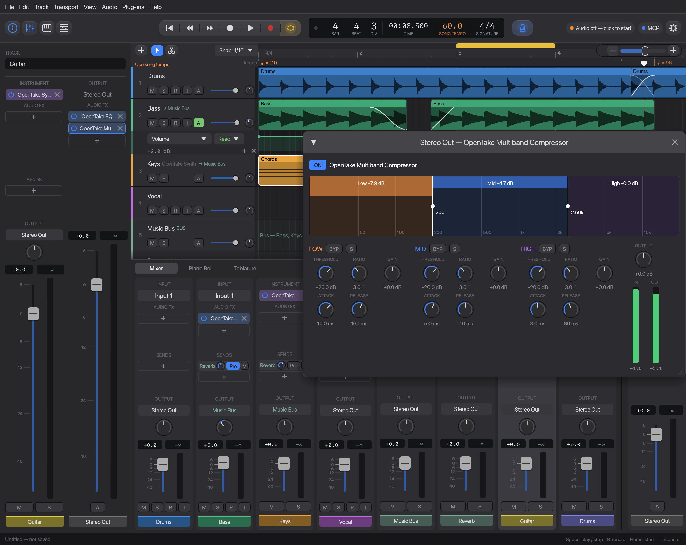

<p align="center">
  <picture>
    <source media="(prefers-color-scheme: dark)" srcset="assets/logo/opentake-wordmark-dark.png">
    
  </picture>
</p>

# OpenTake

**The open-source DAW you can make music with — together with your AI agent.**

OpenTake is a fast, native digital audio workstation written in Rust. Record from your
audio interface, arrange audio and MIDI, play VST3 instruments and effects, and mix —
in a clean, Logic-inspired interface. Every part of a session is also exposed over the
[Model Context Protocol](https://modelcontextprotocol.io), so an AI agent can work in the
same project you have open: create tracks, write MIDI, set up plug-ins, edit and mix while
you watch the changes appear live — and undo anything you don't like.

- 🎙️ Multitrack recording from any audio interface (CoreAudio, WASAPI, ALSA/JACK via cpal), latency-compensated with a built-in loopback measurement
- 🎹 Instrument tracks, piano roll, a built-in synth and GM drum kit; VST3 instruments and effects, plus Audio Units on macOS
- 🎛️ Built-in EQ, compressor, multiband compressor, limiter, delay, reverb, gate, de-esser, chorus and phaser on any track or the master bus; plug-in delay compensation
- 🔀 Buses and sends: route tracks into a bus, or send them pre/post-fader to a shared reverb or delay bus
- 🔑 Side-chain inputs for dynamics: key a compressor, gate, limiter, multiband or de-esser (or a side-chain-capable VST3 / AU) from another track, e.g. a kick pumping a pad
- 📈 Automation of volume, pan, mute and any plug-in parameter, in lanes under each track, with Read, Touch and Latch modes
- ⏱️ Project tempo map (tempo and time-signature changes), metronome with count-in
- 🔁 Cycle recording: loop a section and record take after take, then pick the one that plays
- ✂️ Region editing: select, move, copy, split, trim, snap, cycle/loop; region gain and normalize;
  fades, crossfades and click-free merging of regions
- 🎚️ Full mixer, metronome, undo/redo for everything
- 💾 Export the mix and stems to WAV or FLAC, faster than real time
- 🤖 MCP server (stdio or HTTP) with 84 tools — the agent and you share one session
- 📂 Its own `.otp` project files (double-click to open), Reaper `.rpp` and DAWproject (Bitwig, Studio One, Cubase) projects
- 🔀 Imports Ableton Live sets (`.als`), Ardour sessions, and Logic Pro projects exported as Final Cut Pro XML
- 🎸 Imports Guitar Pro 7/8 songs (`.gp`) as MIDI tracks for VST instruments or the built-in synth, with the tablature shown in sync with the timeline
- 🎼 Imports and exports Standard MIDI Files (`.mid`): one instrument track per part, with the file's tempo map
- 🦀 Real-time safe audio engine: no locks or allocation on the audio thread

## Download

Latest build (rebuilt from `main` on every push):

| Platform | Download |
|---|---|
| macOS — Apple Silicon | [opentake-macos-arm64.zip](https://github.com/jalagus/opentake/releases/download/nightly/opentake-macos-arm64.zip) |
| macOS — Intel | [opentake-macos-x86_64.zip](https://github.com/jalagus/opentake/releases/download/nightly/opentake-macos-x86_64.zip) |
| Windows (x86_64) | [opentake-windows-x86_64.zip](https://github.com/jalagus/opentake/releases/download/nightly/opentake-windows-x86_64.zip) |
| Linux (x86_64) | [opentake-linux-x86_64.tar.gz](https://github.com/jalagus/opentake/releases/download/nightly/opentake-linux-x86_64.tar.gz) |

Tagged versions (`v*`) get their own [release](https://github.com/jalagus/opentake/releases).

The builds aren't signed yet:

- **macOS**: unzip and move `OpenTake.app` to Applications. The first time, right-click it →
  Open (or run `xattr -dr com.apple.quarantine /Applications/OpenTake.app`).
- **Windows**: SmartScreen may warn — choose More info → Run anyway.
- **Linux**: needs ALSA and GTK 3 (`libasound2`, `libgtk-3-0`), present on most desktops.

## Layout

| Crate | What it does |
|---|---|
| `crates/opentake-project` | Project model (tracks, clips, plugin slots), Reaper `.rpp` import/export, Guitar Pro 7/8 reader |
| `crates/opentake-vst3` | VST3 hosting: bundle scanning, loading, parameters, state, realtime processing |
| `crates/opentake-au` | Audio Unit hosting on macOS (AudioToolbox): listing, loading, parameters, state, host transport, realtime processing |
| `crates/opentake-engine` | cpal audio I/O, lock-free mixer, WAV recorder, control-side `Engine` API |
| `crates/opentake` | `opentake` binary: egui GUI, MCP server (stdio or streamable HTTP), small CLI |

### Realtime design

```
 MCP tools ──▶ Engine (control thread) ──Command ring──▶ Mixer (audio callback)
                    ▲                                      │  │
                    └──────── Garbage ring (freed here) ◀──┘  └─▶ record ring ─▶ Recorder thread ─▶ WAV
```

The audio callback never locks or allocates. Structural changes (new track, inserted
plugin, ...) are built on the control side and sent as boxes over an `rtrb` ring;
anything removed is returned and dropped on a GC thread. Input is passed from the
input stream to the output stream through another ring, and recording copies raw
input to a disk-writer thread.

## Usage

```sh
cargo build --release
./target/release/opentake                 # GUI + MCP server at http://127.0.0.1:8808/mcp
./target/release/opentake serve           # headless, MCP over stdio (for agents that launch it)
./target/release/opentake serve --http 127.0.0.1:8808   # headless, MCP over HTTP
./target/release/opentake devices         # list audio interfaces
./target/release/opentake scan            # list VST3 plugins (and Audio Units on macOS)
```

Options: `--project song.rpp` (open on start), `--no-input` (output only), `--no-mcp` (GUI without
MCP server), `--http ADDR`, `--start-audio` (headless), `--plugin-path DIR` (repeatable).
Logs go to stderr; set `RUST_LOG=debug` for more. Settings (VST3 scan folders, recent projects)
live in `~/Library/Application Support/OpenTake/settings.json` (the platform config dir
elsewhere); set `OPENTAKE_CONFIG_DIR` to keep them somewhere else.

### GUI


<p>
  
  
  
</p>

A dark, Logic Pro–inspired interface. The GUI and the MCP server share one engine, so
whatever an agent does appears live in the window, and everything you do is visible to the
agent.

- **Record and arrange**: audio and instrument tracks; move, trim, split, copy and loop regions
  with snapping; tempo and time-signature changes; a metronome with count-in.
- **MIDI**: a built-in synth and drum kit or any VST3 / Audio Unit instrument, edited in the piano roll.
- **Guitar Pro import**: drop a `.gp` file to get one instrument track per part, the song's
  tempo map, and tablature or notation that scrolls along with the arrangement (**T**).
- **MIDI files**: drop a `.mid` file (or File → Import MIDI File…) to pick its parts; each
  becomes an instrument track (channel 10 on the drum kit). File → Export MIDI File… writes
  the MIDI regions back out.
- **Mix**: an inspector and a mixer (**I**, **X**), plus built-in EQ, compressor, multiband compressor, limiter,
  delay, reverb, gate, de-esser, chorus and phaser alongside VST3 and Audio Unit effects. The reverb (pre-delay,
  size, decay, damping, low cut, width, diffusion, modulation) shows its decay tail as you turn
  the knobs; it starts 100% wet for a reverb bus, so turn Mix down when using it as an insert.
  The gate (threshold, hysteresis, hold, range, key filters) and de-esser (frequency, threshold,
  range; split or wideband, Listen to hear the detected band) show their gain reduction over time.
  The chorus (1–4 voices) shows each voice's sweeping delay, and the phaser (2–12 stages) its
  notches across the swept range.
  Plug-in latency is compensated automatically.
- **Buses**: Track → New Bus (or Create Bus from Selection), then pick a track's Output in
  the inspector or mixer; effects on the bus process the whole group.
- **Sends**: the Sends slots under a strip's Audio FX feed buses besides the output. Click the
  empty slot for a bus, a new bus or **New Reverb Send**; each send has its bus (click to change
  it, or No Send), a level knob (double-click: 0 dB), Pre (pre-fader) and M (mute). A bus strip
  counts the tracks and sends feeding it. Send levels can be automated like the fader.
- **Side chain (ducking / pumping)**: a dynamics plug-in's window has a **Side Chain** menu in its
  header (built-in compressor, multiband, limiter, gate and de-esser, and VST3 / AU effects with a
  side-chain input). To make a pad or bass pump with the kick: put a compressor on the pad, set
  Side Chain to the kick track, then a low threshold (−30 to −40 dB), a high ratio (8:1–20:1), a
  fast attack (~1 ms) and a 100–200 ms release; raise Key Low Cut so the kick's sub doesn't
  dominate. **PRE** taps the kick before its fader and mute, so a muted "ghost" kick still keys
  (post-fader, the default, follows them). A gate keyed by a drum opens on its hits. The editor
  shows **KEY ‹track›** and the mixer slot a small key; the key is lined up through plug-in delay.
- **Automation**: the **A** button in a track header (or **A** for all tracks, View → Show
  Automation, or the track's context menu) shows its automation lanes right under it; the **A**
  on the Stereo Out strip (or View → Show Master Automation) shows the master's below the tracks. Pick what a
  lane moves (volume, pan, mute, a send level or any plug-in parameter) in its header, click to add points
  (snapped), drag them (Shift: fine), double-click or ⌫ to delete; right-click a point for its
  curve (linear, hold, smooth, fast start/end). In Read, faders and knobs follow the lane; moved
  while stopped they set the point at the playhead. Touch and Latch record control moves while
  playing. The master's volume and plug-ins can be automated too (over MCP).
- **Region gain**: select an audio region and set its Gain in the inspector, or Normalize it so
  its peak reaches 0 dBFS.
- **Fades and crossfades**: hover an audio region and drag the small square in its top-left
  (fade in) or top-right (fade out) corner; the inspector sets the lengths and curves (linear,
  equal power, exponential, logarithmic, S-curve), as does the region menu's Fade In / Fade Out.
  Overlapping regions on a track crossfade automatically (equal power, drawn as an X); select two
  neighbours and choose Edit → Crossfade Regions (or a length from the region menu's Crossfade)
  to overlap them around their boundary.
- **Merge regions**: select two or more audio regions on a track and press ⌘J (Edit → Merge
  Regions). They're rendered into one new file in the project's Audio folder — gain, fades,
  pitch/stretch and the active take included, gaps as silence — with a 5 ms crossfade where
  regions butt against each other, so the join doesn't click. Undo restores the originals.
- **Arrange tracks**: drag a track's header (or its mixer strip) to move it; click a strip to
  select its track. The buttons left of the transport show the inspector, mixer, piano roll and
  tablature.
- **Recording**: armed tracks monitor their input while stopped and while recording (Transport →
  Auto Input Monitoring; turn it off if your interface monitors directly), and show a red region
  growing with the playhead while they record.
- **Dynamics**: the compressor and limiter show a scrolling gain-reduction history.
- **Takes**: record with the cycle on and each pass becomes a take in one region; its badge
  (e.g. 3/5) picks the take that plays, and recording the same cycle again adds more.
- **Latency compensation**: recordings land where you played them. Audio Settings → Measure
  Latency checks the device's figure with a loopback (a cable, or speakers into a microphone).
- **Pitch and stretch**: transpose an audio region (semitones and cents) and time-stretch it,
  each without changing the other: use the inspector, or ⌥-drag the region's end to stretch it
  to the grid. Uses Signalsmith Stretch (MIT).
- **Export**: the mix and stems as WAV or FLAC (File → Export Audio…, ⇧⌘E).
- **Undo everything**: ⌘Z / ⇧⌘Z, including edits made by an agent.

Projects save as `.otp` (JSON), and the last one reopens on start. Space plays, R records and
C toggles the cycle; the menus list every other shortcut.

### Connect an agent

With the GUI running, connect over HTTP:

```sh
claude mcp add --transport http opentake http://127.0.0.1:8808/mcp
```

Or let the agent launch a headless instance over stdio:

```sh
claude mcp add opentake -- /absolute/path/to/target/release/opentake serve
```

### What to ask

A few ideas (more in **[docs/mcp-examples.md](docs/mcp-examples.md)**, with worked examples
of the tool calls behind them):

- "Import `~/Songs/riff.gp` with the drum kit for drums and use the song's tempo map."
- "Loop bars 17–24 with a two-bar count-in so I can practise the solo."
- "Arm the Guitar track on input 1 and record from bar 9."
- "Cycle bars 5–8 so I can record a few takes of the chorus vocal." Then: "Play take 3."
- "Write a root-note bass line for an A–F–C–G progression over bars 1–8."
- "Do a balanced mix that works on phones and studio monitors." The agent measures with
  `analyze_mix`, adjusts levels, pans and EQs, and re-checks until it's right.
- "What did you change in the last ten steps? Undo the EQ changes but keep the levels."

### Tools

`get_status`, `list_audio_devices`, `start_audio`, `stop_audio`, `undo`, `redo`, `get_history`,
`get_project`, `get_midi_notes`, `analyze_mix`, `export_audio`, `new_project`, `load_project`, `save_project`, `set_tempo`, `set_tempo_map`, `get_tempo_map`, `convert_time`,
`set_master_volume`, `set_metronome`, `set_auto_input_monitoring`, `set_count_in`, `set_loop`,
`add_track`, `add_bus`, `add_send`, `update_send`, `remove_send`, `move_track`, `remove_track`, `update_track`, `add_clip`, `move_clip`, `copy_clip`, `split_clip`, `trim_clip`, `set_clip_gain`, `normalize_clip`, `set_clip_pitch_stretch`, `set_clip_fades`, `crossfade_clips`, `merge_clips`, `remove_clip`,
`play`, `stop`, `seek`, `record`,
`scan_plugins`, `insert_plugin`, `remove_plugin`, `insert_master_plugin`, `remove_master_plugin`, `set_plugin_bypass`,
`list_plugin_params`, `set_plugin_param`, `set_sidechain` (`"eq"` inserts the built-in EQ; `master: true` addresses the master bus),
`list_instruments`, `add_instrument_track`, `set_instrument`, `list_instrument_params`, `set_instrument_param`,
`add_midi_clip`, `set_midi_notes`, `add_midi_notes`, `update_midi_clip`, `copy_midi_clip`, `remove_midi_clip`,
`inspect_guitar_pro`, `import_guitar_pro`, `inspect_midi_file`, `import_midi_file`, `export_midi_file`,
`list_automation_params`, `get_automation`, `add_automation_lane`, `set_automation_points`, `clear_automation`,
`set_automation_lane`, `remove_automation_lane`.

Automation: `list_automation_params` lists what a track (or `master: true`) can automate;
`add_automation_lane` creates a lane and `set_automation_points` draws it, with times in seconds
and values normalized 0..1, or `db` for volume and `pan` (-1..1) for pan. Lanes play during
playback and in `analyze_mix` / `export_audio`.

Mixing: `analyze_mix` renders the mix offline (built-in instruments and EQs, audio regions,
faders, pans, master) and reports, per track and for the master, the peak, integrated loudness
(LUFS, ITU BS.1770), energy per frequency band, and how much loudness survives a phone speaker.
An agent can balance a mix by numbers — adjust `update_track` / EQs, re-analyze, repeat —
keeping the master peak under -1 dBFS and the phone drop similar across tracks.

Recording: arm a track (`update_track` with `armed: true` and `input_channel`), call
`record`, then `stop`. Each armed track gets a mono 32-bit float WAV in
`<project dir>/Audio/`, and it's added to the track as a clip.

## Reaper projects

`load_project`/`save_project` pick the format from the extension (`.rpp` vs `.otp`;
`.json` files from earlier versions still open).
Supported: tempo/time signature and the tempo map (tempo envelope), sample rate, master volume, loop range (`LOOP`/`SELECTION`), track name/volume/pan/mute/solo/
record-arm/input/monitoring, audio items (position, length, source offset, gain, mute,
play rate / pitch, fades (`FADEIN`/`FADEOUT`, shapes mapped to the nearest), media file), FX chain references, buses (written as receives; folders and receives
from tracks with the master send off import as buses), sends (receives with their volume, mute
and mode: post-fader, or pre-fader; Reaper's pre-FX loads as pre-fader), and volume/pan/mute envelopes
(`VOLENV2`/`PANENV2`/`MUTEENV`). VST3 plugins in a Reaper project are matched by
bundle file name and class id/name and loaded if installed; Audio Units by their
type/subtype/manufacturer codes or name.

Not (yet) supported: plug-in parameter envelopes (`PARMENV`, which number parameters by
position), fader-scaled volume envelopes, send envelopes, MIDI items, takes beyond the
first, and Reaper's opaque plugin state blobs. Those are kept in the model and written
back on export, but they aren't applied to the loaded plugin.

## Projects from other DAWs

Open them like any project (File → Open, drag and drop, or `load_project`); what couldn't be
carried over is listed as warnings. An imported project has no path until you save it, so the
original file is never overwritten.

- **DAWproject** (`.dawproject`; Bitwig Studio, Studio One, Cubase 14+): tracks, volume/pan/
  mute/solo, audio clips (embedded audio is extracted to `<name> Media/` next to the file),
  MIDI clips, clip loops, tempo and time-signature automation, plug-in references. Also
  **exported** (Save As → DAWproject) with the audio embedded, to take a project into those DAWs.
- **Ableton Live** (`.als`, Live 9–12): audio and MIDI tracks, arrangement clips with
  start/loop markers, mixer, tempo automation, plug-in references. Live's own devices become
  the built-in synth/drums or are skipped; session-view clips aren't imported.
- **Logic Pro**: `.logicx` is a closed format and can't be opened. In Logic choose
  File → Export → Project to Final Cut Pro XML and open the `.fcpxml`: audio regions arrive on
  tracks per role/lane with their positions, offsets and volume. FCPXML has no MIDI, tempo or
  mixer, so set the tempo afterwards, and bring MIDI over as audio (bounce) or MIDI files.
- **Ardour** (`.ardour`, Ardour 5–8): audio tracks and their regions, gain/pan/mute/solo,
  tempo map. MIDI regions (kept in separate `.mid` files), buses and sends aren't imported.

Common limits: warped/time-stretched clips play at their original speed, plug-in states
(presets) aren't transferred (VST3 plug-ins are found by name and start at their defaults),
automation other than tempo, sends/returns and fades aren't imported.

## Known limitations / next steps

- f32 devices only (fine for CoreAudio; some ASIO/ALSA setups need sample conversion).
- Audio import is WAV only (export also writes FLAC); add `symphonia` for MP3/FLAC/OGG.
  Resampling is linear.
- Recording latency comes from what the device reports; some devices misreport it (the
  built-in Mac audio by 20–40 ms), so measure it once per setup (Audio Settings → Measure Latency).
- VST3: no plugin editor windows (generic parameter sliders instead) and no `IMessage` host
  objects (some plugins need them for processor ↔ controller messaging). Plugin
  parameters are saved by value, but full state chunks aren't saved yet. Instruments get
  note events only and haven't been tested with many third-party plugins.
- Audio Units (macOS only): no editor windows (generic sliders), stereo/mono main bus plus a
  side chain on a second input element (no extra outputs), notes only (no pitch bend/CC). State is saved as the
  unit's property list; Reaper's AU state may not restore. AUv3 extensions that load only
  asynchronously wait up to 10 s and fail if they need the main thread meanwhile.
- Plugin parameter values, MIDI regions, the built-in synth/drums/effects and master-bus effects
  are saved in `.otp` projects only (`.rpp` export skips them; VST3 instruments are exported).
- Guitar Pro: only GP7/8 (`.gp`, `.gpif`); `.gp3`–`.gp5` and `.gpx` are recognised but not
  imported yet. Bends, slides and vibrato aren't played back (no pitch bend yet).
  `cargo run -p opentake-project --example gpinfo -- song.gp` prints what the reader sees.
- MIDI files: notes, tempo and time signatures are imported (format 0/1; format 2 is read
  as parallel tracks); program changes only pick names, and CC, pitch bend and lyrics are skipped.
- MIDI: no MIDI input / recording yet, no CC/pitch-bend; notes are in seconds, so changing
  the tempo map doesn't stretch existing regions (they keep their real-time positions).
- Takes: one plays at a time (no comping from parts of several takes yet), and a take folder
  doesn't expand into take lanes.
- Tempo map: steps only (no gradual tempo ramps); Reaper ramps are imported as steps.
- Pitch/stretch: one ratio per region (no Flex markers, no varispeed mode), formants are not
  preserved, and stretch is limited to 0.25–4×. Each new setting renders the region first:
  long regions take about a second per minute, in the background in the GUI. A pitched or
  stretched region doesn't collect new cycle-recording takes.
- Regions: automatic crossfades only cover partial overlaps (a region lying inside another just
  adds to it), and merged regions bake their fades in. Fade curves are mapped to Reaper's
  nearest shapes, and fades aren't imported from other DAWs.
- Buses: stems export what reaches the master: a bus is one stem with its sources and what
  sends bring to it inside, and a track's stem is its dry signal. Pre-fader sends ignore the
  fader and pan but not the track's mute; sends can't be reordered.
- Side chains: only effect slots take a key (not instruments); a key that would make a loop (from a track
  mixed after the keyed one) is refused. A keyed track is read late enough to line the key
  up, which can add to the total plug-in delay. VST3 side chains use the plug-in's first aux input
  bus (stereo or mono as it declares); side-chain VST3s / AUs have had little third-party testing,
  and `.rpp` / DAWproject export drops keys.
- Automation: plug-in parameters change once per 64-sample block (fader, pan and mute ramp
  within it), so changes land within ~1.3 ms of their point; plug-in editor windows don't follow
  automated values; no automation of region gain, and Touch/Latch only record from the GUI.

## Development

```sh
cargo test                     # unit tests + headless GUI interaction tests (egui_kittest)
OPENTAKE_SCREENSHOT=/tmp/ui.png cargo test -p opentake render_screenshot -- --ignored   # render the GUI to PNGs (README screenshots)
```

## License

OpenTake is released under the [MIT License](LICENSE).
