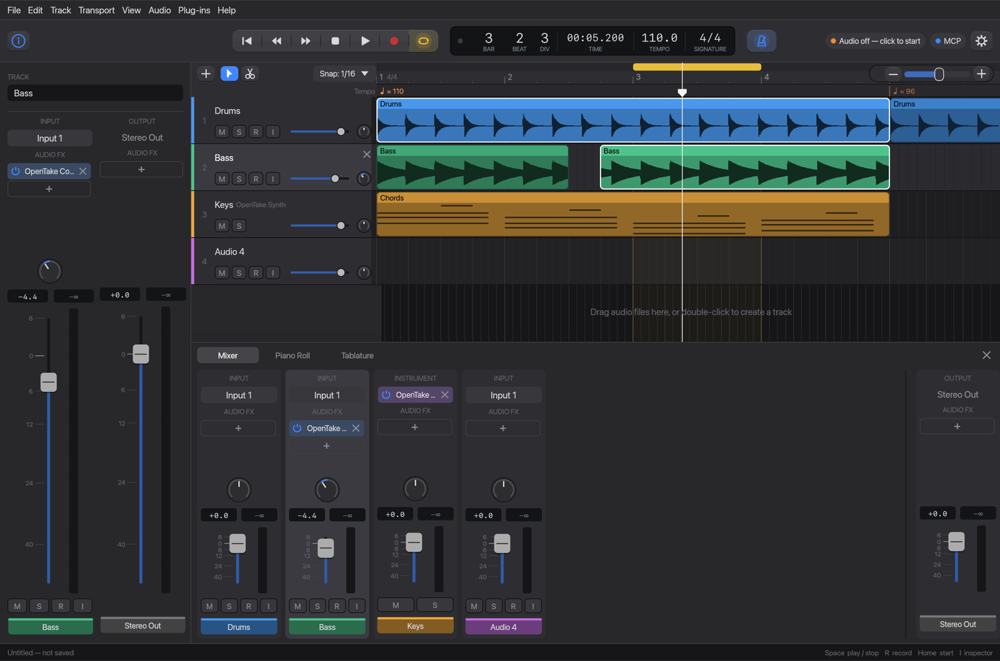
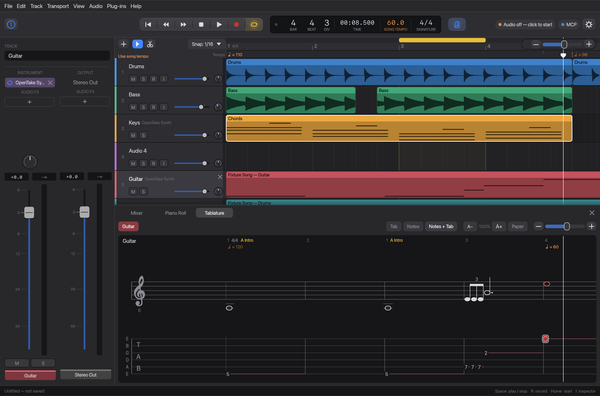
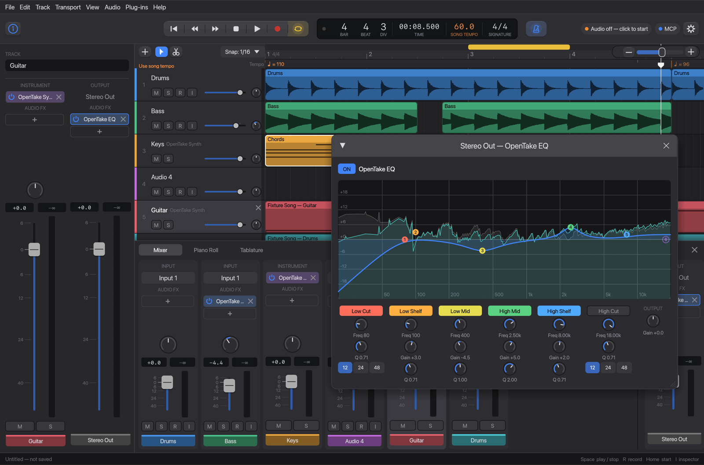

<p align="center">
  <picture>
    <source media="(prefers-color-scheme: dark)" srcset="assets/logo/opentake-wordmark-dark.png">
    
  </picture>
</p>

# OpenTake

**The open-source DAW you can make music with — together with your AI agent.**

OpenTake is a fast, native digital audio workstation written in Rust. Record from your
audio interface, arrange audio and MIDI, play VST3 instruments and effects, and mix —
in a clean, Logic-inspired interface. Every part of a session is also exposed over the
[Model Context Protocol](https://modelcontextprotocol.io), so an AI agent can work in the
same project you have open: create tracks, write MIDI, set up plug-ins, edit and mix while
you watch the changes appear live — and undo anything you don't like.

- 🎙️ Multitrack recording from any audio interface (CoreAudio, WASAPI, ALSA/JACK via cpal)
- 🎹 Instrument tracks, piano roll, a built-in synth and GM drum kit; VST3 instruments and effects
- 🎛️ Built-in EQ, compressor, limiter and delay on any track or the master bus; plug-in delay compensation
- ⏱️ Project tempo map (tempo and time-signature changes), metronome with count-in
- ✂️ Region editing: select, move, copy, split, trim, snap, cycle/loop
- 🎚️ Full mixer, metronome, undo/redo for everything
- 💾 Export the mix and stems to WAV or FLAC, faster than real time
- 🤖 MCP server (stdio or HTTP) with 57 tools — the agent and you share one session
- 📂 Its own `.otp` project files (double-click to open), and Reaper `.rpp` projects
- 🎸 Imports Guitar Pro 7/8 songs (`.gp`) as MIDI tracks for VST instruments or the built-in synth, with the tablature shown in sync with the timeline
- 🦀 Real-time safe audio engine: no locks or allocation on the audio thread

## Download

Latest build (rebuilt from `main` on every push):

| Platform | Download |
|---|---|
| macOS — Apple Silicon | [opentake-macos-arm64.zip](https://github.com/jalagus/opentake/releases/download/nightly/opentake-macos-arm64.zip) |
| macOS — Intel | [opentake-macos-x86_64.zip](https://github.com/jalagus/opentake/releases/download/nightly/opentake-macos-x86_64.zip) |
| Windows (x86_64) | [opentake-windows-x86_64.zip](https://github.com/jalagus/opentake/releases/download/nightly/opentake-windows-x86_64.zip) |
| Linux (x86_64) | [opentake-linux-x86_64.tar.gz](https://github.com/jalagus/opentake/releases/download/nightly/opentake-linux-x86_64.tar.gz) |

Tagged versions (`v*`) get their own [release](https://github.com/jalagus/opentake/releases).

The builds aren't signed yet:

- **macOS**: unzip and move `OpenTake.app` to Applications. The first time, right-click it →
  Open (or run `xattr -dr com.apple.quarantine /Applications/OpenTake.app`).
- **Windows**: SmartScreen may warn — choose More info → Run anyway.
- **Linux**: needs ALSA and GTK 3 (`libasound2`, `libgtk-3-0`), present on most desktops.

## Layout

| Crate | What it does |
|---|---|
| `crates/opentake-project` | Project model (tracks, clips, plugin slots), Reaper `.rpp` import/export, Guitar Pro 7/8 reader |
| `crates/opentake-vst3` | VST3 hosting: bundle scanning, loading, parameters, state, realtime processing |
| `crates/opentake-engine` | cpal audio I/O, lock-free mixer, WAV recorder, control-side `Engine` API |
| `crates/opentake` | `opentake` binary: egui GUI, MCP server (stdio or streamable HTTP), small CLI |

### Realtime design

```
 MCP tools ──▶ Engine (control thread) ──Command ring──▶ Mixer (audio callback)
                    ▲                                      │  │
                    └──────── Garbage ring (freed here) ◀──┘  └─▶ record ring ─▶ Recorder thread ─▶ WAV
```

The audio callback never locks or allocates. Structural changes (new track, inserted
plugin, ...) are built on the control side and sent as boxes over an `rtrb` ring;
anything removed is returned and dropped on a GC thread. Input is passed from the
input stream to the output stream through another ring, and recording copies raw
input to a disk-writer thread.

## Usage

```sh
cargo build --release
./target/release/opentake                 # GUI + MCP server at http://127.0.0.1:8808/mcp
./target/release/opentake serve           # headless, MCP over stdio (for agents that launch it)
./target/release/opentake serve --http 127.0.0.1:8808   # headless, MCP over HTTP
./target/release/opentake devices         # list audio interfaces
./target/release/opentake scan            # list VST3 plugins
```

Options: `--project song.rpp` (open on start), `--no-input` (output only), `--no-mcp` (GUI without
MCP server), `--http ADDR`, `--start-audio` (headless), `--plugin-path DIR` (repeatable).
Logs go to stderr; set `RUST_LOG=debug` for more. Settings (VST3 scan folders, recent projects)
live in `~/Library/Application Support/OpenTake/settings.json` (the platform config dir
elsewhere); set `OPENTAKE_CONFIG_DIR` to keep them somewhere else.

### GUI



<p>
  
  
</p>

A dark, Logic Pro–inspired interface. The GUI and the MCP server share one engine, so
whatever an agent does appears live in the window, and everything you do is visible to the
agent.

- **Record and arrange**: audio and instrument tracks; move, trim, split, copy and loop regions
  with snapping; tempo and time-signature changes; a metronome with count-in.
- **MIDI**: a built-in synth and drum kit or any VST3 instrument, edited in the piano roll.
- **Guitar Pro import**: drop a `.gp` file to get one instrument track per part, the song's
  tempo map, and tablature or notation that scrolls along with the arrangement (**T**).
- **Mix**: an inspector and a mixer (**I**, **X**), plus built-in EQ, compressor, limiter and
  delay alongside VST3 effects. Plug-in latency is compensated automatically.
- **Export**: the mix and stems as WAV or FLAC (File → Export Audio…, ⇧⌘E).
- **Undo everything**: ⌘Z / ⇧⌘Z, including edits made by an agent.

Projects save as `.otp` (JSON), and the last one reopens on start. Space plays, R records and
C toggles the cycle; the menus list every other shortcut.

### Connect an agent

With the GUI running, connect over HTTP:

```sh
claude mcp add --transport http opentake http://127.0.0.1:8808/mcp
```

Or let the agent launch a headless instance over stdio:

```sh
claude mcp add opentake -- /absolute/path/to/target/release/opentake serve
```

### What to ask

A few ideas (more in **[docs/mcp-examples.md](docs/mcp-examples.md)**, with worked examples
of the tool calls behind them):

- "Import `~/Songs/riff.gp` with the drum kit for drums and use the song's tempo map."
- "Loop bars 17–24 with a two-bar count-in so I can practise the solo."
- "Arm the Guitar track on input 1 and record from bar 9."
- "Write a root-note bass line for an A–F–C–G progression over bars 1–8."
- "Do a balanced mix that works on phones and studio monitors." The agent measures with
  `analyze_mix`, adjusts levels, pans and EQs, and re-checks until it's right.
- "What did you change in the last ten steps? Undo the EQ changes but keep the levels."

### Tools

`get_status`, `list_audio_devices`, `start_audio`, `stop_audio`, `undo`, `redo`, `get_history`,
`get_project`, `get_midi_notes`, `analyze_mix`, `export_audio`, `new_project`, `load_project`, `save_project`, `set_tempo`, `set_tempo_map`, `get_tempo_map`, `convert_time`,
`set_master_volume`, `set_metronome`, `set_count_in`, `set_loop`,
`add_track`, `remove_track`, `update_track`, `add_clip`, `move_clip`, `copy_clip`, `split_clip`, `trim_clip`, `remove_clip`,
`play`, `stop`, `seek`, `record`,
`scan_plugins`, `insert_plugin`, `remove_plugin`, `insert_master_plugin`, `remove_master_plugin`, `set_plugin_bypass`,
`list_plugin_params`, `set_plugin_param` (`"eq"` inserts the built-in EQ; `master: true` addresses the master bus),
`list_instruments`, `add_instrument_track`, `set_instrument`, `list_instrument_params`, `set_instrument_param`,
`add_midi_clip`, `set_midi_notes`, `add_midi_notes`, `update_midi_clip`, `copy_midi_clip`, `remove_midi_clip`,
`inspect_guitar_pro`, `import_guitar_pro`.

Mixing: `analyze_mix` renders the mix offline (built-in instruments and EQs, audio regions,
faders, pans, master) and reports, per track and for the master, the peak, integrated loudness
(LUFS, ITU BS.1770), energy per frequency band, and how much loudness survives a phone speaker.
An agent can balance a mix by numbers — adjust `update_track` / EQs, re-analyze, repeat —
keeping the master peak under -1 dBFS and the phone drop similar across tracks.

Recording: arm a track (`update_track` with `armed: true` and `input_channel`), call
`record`, then `stop`. Each armed track gets a mono 32-bit float WAV in
`<project dir>/Audio/`, and it's added to the track as a clip.

## Reaper projects

`load_project`/`save_project` pick the format from the extension (`.rpp` vs `.otp`;
`.json` files from earlier versions still open).
Supported: tempo/time signature and the tempo map (tempo envelope), sample rate, master volume, loop range (`LOOP`/`SELECTION`), track name/volume/pan/mute/solo/
record-arm/input/monitoring, audio items (position, length, source offset, gain, mute,
media file) and FX chain references. VST3 plugins in a Reaper project are matched by
bundle file name and class id/name and loaded if installed.

Not (yet) supported: envelopes/automation, MIDI items, sends/folders, takes beyond the
first, and Reaper's opaque plugin state blobs. Those are kept in the model and written
back on export, but they aren't applied to the loaded plugin.

## Known limitations / next steps

- f32 devices only (fine for CoreAudio; some ASIO/ALSA setups need sample conversion).
- WAV media only; add `symphonia` for MP3/FLAC/OGG. Resampling is linear.
- No compensation for audio-interface input latency yet (recordings may sit a few ms late);
  plug-in delay is compensated.
- VST3: no MIDI/instruments yet, no plugin editor windows, and no `IMessage` host
  objects (some plugins need them for processor ↔ controller messaging). Plugin
  parameters are saved by value in our JSON format, but full state chunks aren't saved yet.
- Plugin parameter values, MIDI regions, the built-in synth/drums/effects and master-bus effects
  are saved in `.otp` projects only (`.rpp` export skips them; VST3 instruments are exported).
- Guitar Pro: only GP7/8 (`.gp`, `.gpif`); `.gp3`–`.gp5` and `.gpx` are recognised but not
  imported yet. Bends, slides and vibrato aren't played back (no pitch bend yet).
  `cargo run -p opentake-project --example gpinfo -- song.gp` prints what the reader sees.
- MIDI: no MIDI input / recording yet, no CC/pitch-bend; notes are in seconds, so changing
  the tempo map doesn't stretch existing regions (they keep their real-time positions).
- Tempo map: steps only (no gradual tempo ramps); Reaper ramps are imported as steps. VST3 instrument hosting is implemented
  (note events on the event bus) but has only been tested with the built-in synth.
- GUI: no plugin editor windows (generic parameter sliders instead), no region fades,
  multi-selection or undo yet.
- No built-in reverb yet (EQ, compressor, limiter and delay are built in; any VST3 reverb works).

## Development

```sh
cargo test                     # unit tests + headless GUI interaction tests (egui_kittest)
OPENTAKE_SCREENSHOT=/tmp/ui.png cargo test -p opentake render_screenshot -- --ignored   # render the GUI to PNGs (README screenshots)
```

## License

OpenTake is released under the [MIT License](LICENSE).
